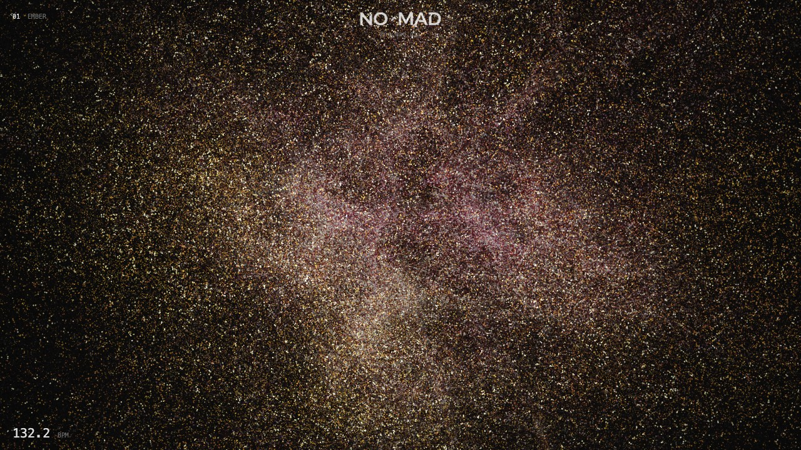
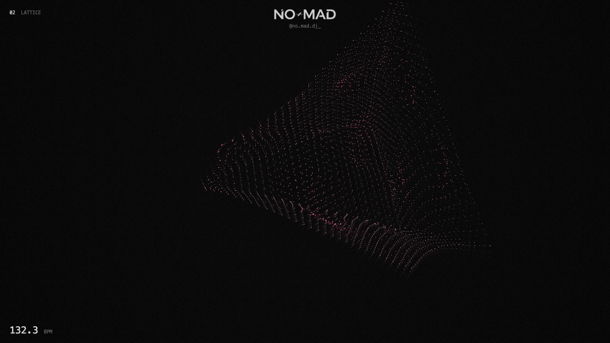
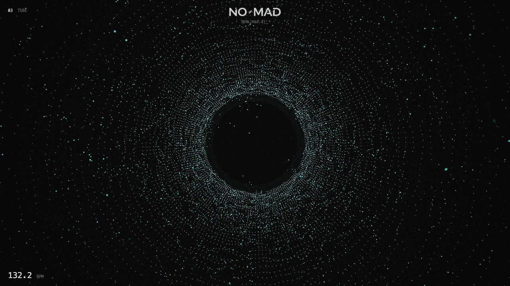
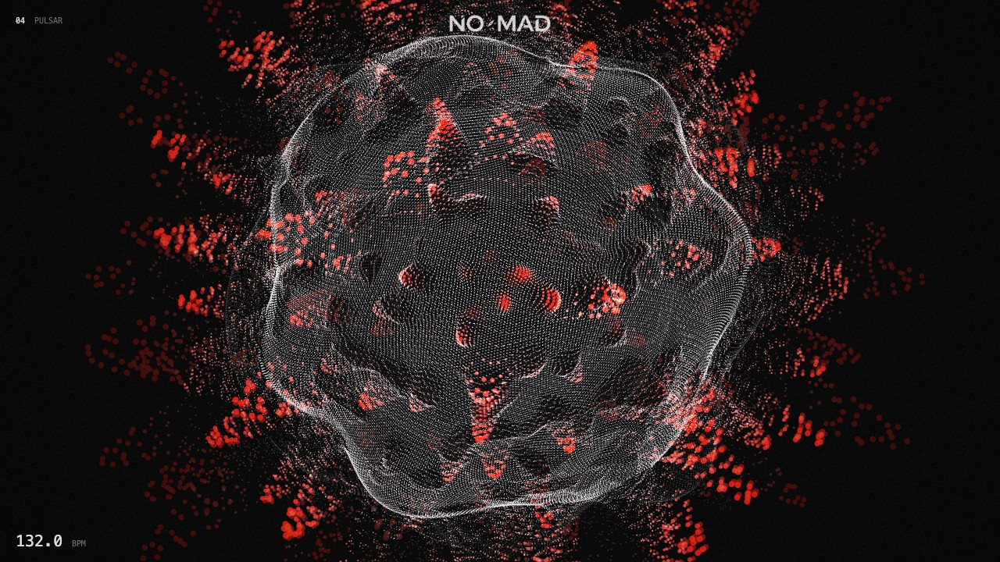
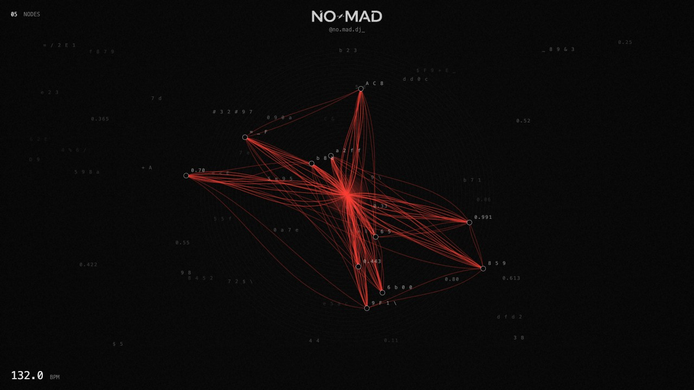
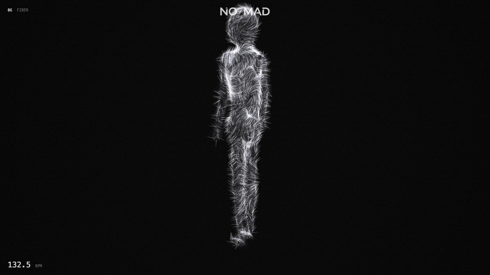
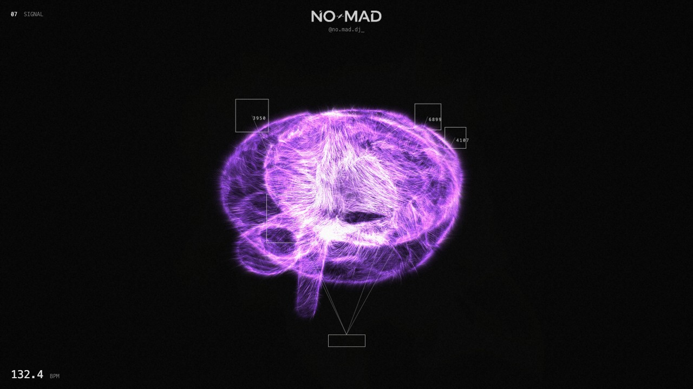
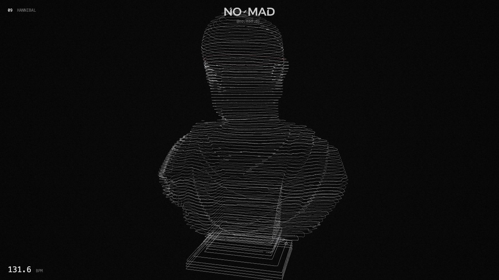
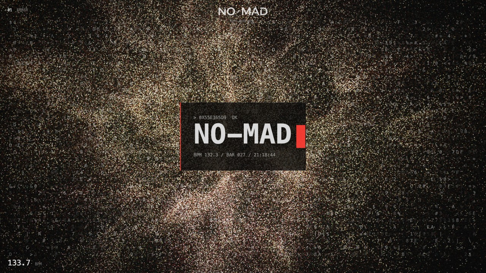

<p align="center">
  <picture>
    <source media="(prefers-color-scheme: dark)" srcset="docs/logo-white.png">
    
  </picture>
</p>

<h3 align="center">NO-MAD Visuals — a live, audio-reactive techno visualiser for DJs</h3>

<p align="center">
  Plug in Traktor (or Mixxx), press start, and nine GPU-driven scenes react to every kick, clap and hat in your set.<br>
  One HTML file. No install, no build step, no cloud — runs offline in Chrome.
</p>

<p align="center">
  <a href="https://www.instagram.com/no.mad.dj_/">Instagram @no.mad.dj_</a>
</p>

<p align="center"></p>

---

## Why

Most VJ tools are either heavy desktop software or loops that ignore the music. NO-MAD Visuals listens to your actual mix: it tracks the beat and the bar, splits the sound into bass, mids and highs, and drives a minimal, dark, black-and-red look built for techno — on a single browser tab next to your DJ software.

## Scenes

Switch with **1–9**, the buttons in the panel, or any pad on your MIDI controller. Each change plays a random glitch / pixel / zoom transition.

| | | |
|:-:|:-:|:-:|
| <br>**1 · EMBER** — 131k particles flowing through a curl-noise field; new colour pair on every beat | <br>**2 · LATTICE** — a pyramid of points; kicks blow points off the grid, beats rebuild and swing it | <br>**3 · TUBE** — looking down a cylinder of points; kicks scatter the walls |
| <br>**4 · PULSAR** — a sphere whose noise spikes grow red on every kick | <br>**5 · NODES** — red bezier strands to nodes that jump on the beat, with data labels | <br>**6 · FIBER** — a human body of combed fibres that bristle on kicks |
| <br>**7 · SIGNAL** — a 3D brain of purple streaks; each kick sends a neural pulse across it | **8 · DETECT** — your webcam or a video under a fake object-detection overlay, with RGB-split, tears, block corruption, freezes and invert flashes on the music | <br>**9 · HANNIBAL** — a sculpted bust as minimal contour lines; a scan band climbs on kicks, one slice turns red on the downbeat |

<p align="center"><br><em>Optional hacker layer: a flickering hex-code field and your own phrases decoding on the beat.</em></p>

## How it reacts

| Sound | What happens |
|---|---|
| **Kick** | Bursts, shockwaves, camera punch, scan bands — the biggest hit in every scene |
| **Downbeat** (beat 1 of the bar) | Red accents, shape rebuilds, pose and camera changes, optional strobe |
| **Bass** | The form breathes and the flow speeds up |
| **Mids / claps** | Turbulence, twists and whips |
| **Hats** | Glitter, sparks, flickering labels |

Each band is measured against its own recent level, so it reacts to the *hits* even on a loud, mastered track — not to overall volume. Analysis runs at a fixed 60 Hz, so it behaves the same on 60, 120 and 144 Hz screens.

## Quick start

1. **Route your DJ software's audio into the browser** with a loopback device:
   - [BlackHole](https://existential.audio/blackhole/) (free) — create a *Multi-Output Device* in Audio MIDI Setup with your speakers + BlackHole, and set Traktor's output to it; **or**
   - [Loopback](https://rogueamoeba.com/loopback/) — make a virtual device with Traktor as its source.
2. **Serve the folder** (browsers need `http://` for audio and MIDI):
   ```bash
   python3 -m http.server 8765
   ```
3. Open **http://localhost:8765** in **Chrome**.
4. Press **S** → **Allow audio + MIDI access** → pick your loopback input → **Start**.

The **B · M · H** meters at the bottom show what the page hears. If they stay flat, the audio routing is the problem.

### Optional: exact tempo from Traktor

Enable *Preferences → MIDI Clock → Send MIDI Clock*, route it to the **IAC Driver** bus, and choose that bus as **Tempo source** in the panel. The beat and bar counter then follow Traktor's master clock exactly. Without it, beats come from kick detection.

## Controls

| Key | Action |
|---|---|
| `1`–`9`, `←` `→` | Scenes |
| `Space` | Trigger the decode text |
| `X` | Hacker layer on/off |
| `O` | Overlay video on/off |
| `T` | Strobe on downbeat (photosensitivity warning) |
| `B` | Blackout (text stays) |
| `F` | Fullscreen |
| `H` | Hide on-screen info |
| `S` | Settings panel |

**MIDI learn:** in the panel, click **Learn** next to any action and press a pad or move a knob. Scenes, text, strobe, blackout, overlay and a **Reactivity** knob can all be mapped. Mappings are saved in the browser.

## Your own files (optional)

In the panel under **05 Your files**, or by saving a file next to `index.html` with these names so it loads automatically:

| File | Used for |
|---|---|
| `font.woff2` / `.ttf` | Typeface for the text and labels |
| `body.obj` | Replaces the built-in body in **FIBER** |
| `brain.obj` or `brain.mp4` | A 3D brain, or a video of a brain on black, for **SIGNAL** |
| `bust.obj` | The statue for **HANNIBAL** (none is included — use any bust or statue `.obj`) |
| `overlay.mp4` / `.webm` | A clip layered over every scene (Screen blend turns black see-through) |

The models and videos shown in the screenshots are not included in this repository.

## Under the hood

- Single `index.html`, plain JavaScript, **WebGL2** — no framework, no dependencies, works offline.
- GPU particle simulation with transform feedback and curl noise; instanced line rendering for fibres and streaks.
- Built-in anatomy is generated from signed-distance functions in a Web Worker, so the page opens instantly.
- Web Audio `AnalyserNode` for bands and onsets; Web MIDI for clock input and MIDI learn.
- DETECT tracks the subject with frame-difference and background modelling — no machine-learning model.

## Credits

- 3D simplex noise by Ian McEwan, Ashima Arts — [webgl-noise](https://github.com/ashima/webgl-noise), MIT License.
- The LATTICE / TUBE point-displacement idea follows [Interactive Particles Music Visualizer](https://github.com/tgcnzn/Interactive-Particles-Music-Visualizer) by tgcnzn (MIT).

---

<p align="center">Made by <strong>NO-MAD</strong> · <a href="https://www.instagram.com/no.mad.dj_/">@no.mad.dj_</a></p>
